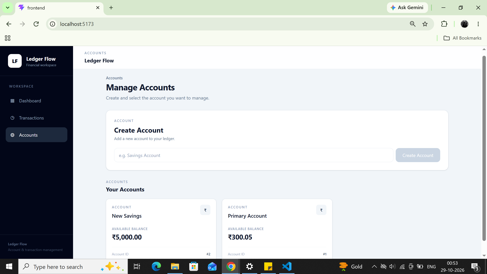
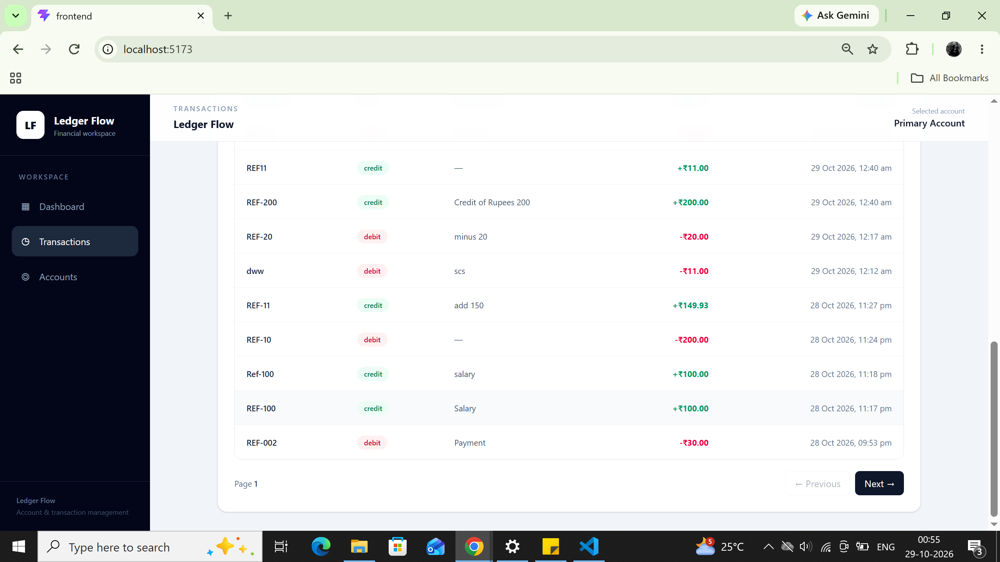
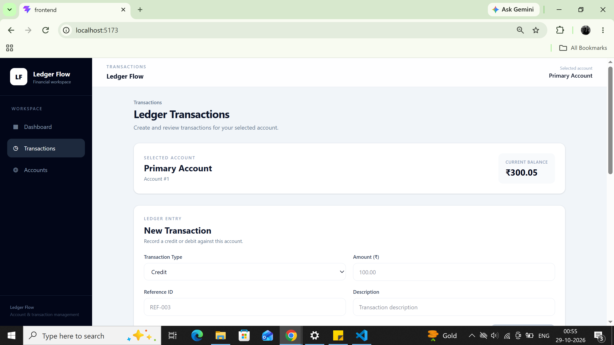
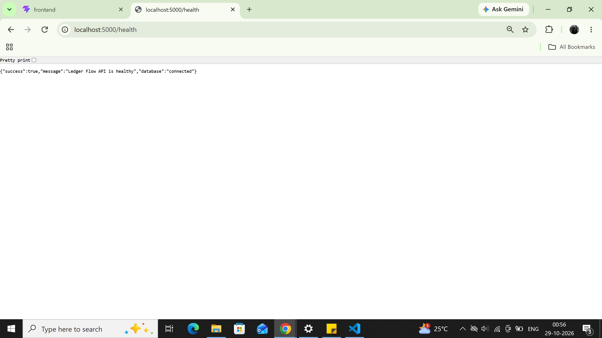

# Ledger Flow

### A modern full-stack ledger and transaction management system

Manage accounts, record credit and debit transactions, and track account balances through a clean React interface backed by a TypeScript REST API.

<p align="center">
  
  
  
  
  
</p>

---

## Table of Contents

- [Overview](#overview)
- [Features](#features)
- [Application Screenshots](#application-screenshots)
- [Architecture](#architecture)
- [Technology Stack](#technology-stack)
- [Getting Started](#getting-started)
- [API Documentation](#api-documentation)
- [Project Structure](#project-structure)
- [Assumptions and Design Decisions](#assumptions-and-design-decisions)
- [Future Improvements](#future-improvements)

---

## Overview

Ledger Flow is a full-stack application for account and transaction management. It demonstrates a layered backend architecture, REST API design, request validation, and database-backed transaction processing.

The application supports account creation, credit and debit operations, balance protection, duplicate transaction reference validation, and paginated transaction history.

## Features

- **Account Management** — Create and view accounts.
- **Credit Transactions** — Record incoming funds.
- **Debit Transactions** — Record outgoing funds.
- **Balance Protection** — Reject debit operations that exceed the available balance.
- **Reference Validation** — Prevent duplicate transaction references within an account.
- **Paginated History** — Retrieve transaction records page by page.
- **Structured API Responses** — Handle validation failures and business-rule errors consistently.
- **Database Constraints** — Support data integrity through schema-level constraints.

---

## Application Screenshots

### 1. Landing Page

The main entry point to Ledger Flow.


### 2. Account Management

View and manage accounts.



### 3. Create Account

Create a new account through the application interface.


### 4. Credit and Debit Operations

Record transactions and validate account balance rules.



### 5. Transaction History

Review account transactions in a structured table.



### 6. Database Tables

Inspect the database tables used by the application.


### 7. Backend Health

View the backend health endpoint response.



---

## Architecture

The application separates frontend presentation, HTTP request handling, business logic, and database access.

```text
┌──────────────────────────────┐
│     React + TypeScript       │
│          Frontend            │
└──────────────┬───────────────┘
               │ HTTP / REST
┌──────────────▼───────────────┐
│      Express API Routes      │
├──────────────────────────────┤
│ Controllers & Validation     │
├──────────────────────────────┤
│         Services             │
├──────────────────────────────┤
│     PostgreSQL Access        │
└──────────────┬───────────────┘
               │ SQL
┌──────────────▼───────────────┐
│          PostgreSQL          │
│   Accounts & Transactions    │
└──────────────────────────────┘
```

## Technology Stack

| Layer | Technologies |
|---|---|
| Frontend | React, TypeScript, Vite, Tailwind CSS |
| Backend | Node.js, Express, TypeScript |
| API | REST |
| Database | PostgreSQL |
| Version Control | Git and GitHub |

## Getting Started

### Prerequisites

- Node.js and npm
- PostgreSQL database
- Git

### 1. Clone the repository

```bash
git clone https://github.com/2yb/ledger-flow.git
cd ledger-flow
```

### 2. Configure the backend

```bash
cd backend
npm install
```

Copy `.env.example` to `.env` and configure the required database connection and server environment variables.

Create the PostgreSQL database and apply the schema from `database/schema.sql`.

Start the backend using the development script configured in `backend/package.json`:

```bash
npm run dev
```

### 3. Configure the frontend

Open a second terminal from the project root:

```bash
cd frontend
npm install
```

Configure the frontend API base URL using the environment variable expected by the application.

Start the frontend:

```bash
npm run dev
```

Open the local URL displayed by Vite.

> **Note:** Use the environment variable names and setup commands defined in the actual project configuration.

## API Documentation

See [API_DOCUMENTATION.md](./API_DOCUMENTATION.md) for endpoint descriptions, request examples, pagination, and error handling.

## Assumptions and Design Decisions

See [ASSUMPTIONS.md](./ASSUMPTIONS.md) for monetary representation, transaction validation, balance rules, and data integrity decisions.

## Project Structure

```text
ledger-flow/
├── backend/
│   ├── database/
│   │   └── schema.sql
│   └── src/
│       ├── config/
│       ├── controllers/
│       ├── middleware/
│       ├── routes/
│       ├── services/
│       └── validators/
├── frontend/
│   └── src/
│       ├── components/
│       └── types/
├── docs/
│   └── screenshots/
├── API_DOCUMENTATION.md
├── ASSUMPTIONS.md
└── README.md
```

## Engineering Considerations

- Validate transaction input before processing.
- Prevent debits that exceed the available balance.
- Enforce transaction-reference uniqueness within an account.
- Use database constraints to help protect data integrity.
- Keep API routing, request handling, and business logic separated.

## Future Improvements

- Expand automated unit and integration test coverage.
- Add authentication and account-level authorization.
- Configure continuous integration for builds and tests.
- Add structured logging and production monitoring.
- Deploy the frontend and backend to a production environment.

---

<p align="center">
  <strong>Ledger Flow</strong><br />
  Built with React, TypeScript, Node.js, Express, and PostgreSQL.
</p>